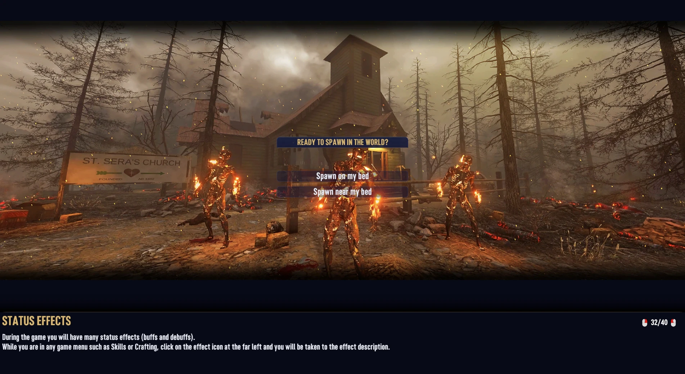

# KitsuneUI

**Kitsunebi**, a night glass interface for 7 Days to Die V3.x: deep indigo glass panels, fox-fire cyan accents and gold titles, across every screen in the game.


| | |
|---|---|
|  |  |
|  |  |
|  |  |

**About the screenshots:** they were taken with separate inventory and container mods installed (a bigger backpack, extra crafting queue and workstation slots, bigger stacks), to show the theme stretching to fit them. Those mods are **not** part of KitsuneUI. With KitsuneUI alone, your bags and workstations keep their vanilla sizes.

The theme is XML and images only. It changes how the game looks, never how it plays, and it runs with EAC on.

## What it covers

- **HUD:** health, stamina, food and water bars with an injury hatch, buff pop-outs lined up with the bars, compass, location box, quest and recipe trackers, party bars, enemy health bar.
- **Toolbelt:** a glass tray that grows to fit one or two bars.
- **Inventory:** backpack, loot, vehicle and drone storage, with rounded slots that glow fox-fire when selected and gold on hover.
- **Crafting:** recipe list, recipe and item details, crafting queue, the creative menu, every workstation (workbench, forge, campfire, chemistry station, cement mixer, dew collector).
- **Trader and quests:** trader stock, services, job offer, quest journal, turn-in rewards.
- **Character:** character sheet, buffs, skills and perks, challenges, cosmetics.
- **Map:** map, waypoints, shared waypoints and the right-click menus.
- **Menus:** main menu, Play Game, the in-game Esc menu, every Options page, death message and respawn screen.
- **Loading screen:** the picture fills the screen and the tip sits in a glass column down the right edge, with the spawn buttons docked at its foot.
- **Everything else:** chat, the player list, power and trap windows, cameras, signs and the sign editor, keypads, tooltips, context menus, tips, message boxes, admin and debug panels.

## Install

1. Download the zips you want from the [Releases](https://github.com/Kitsune-Den/KitsuneUI/releases) page.
2. Unzip each one into your `Mods` folder, so you end up with `Mods/KitsuneUI/ModInfo.xml`. The `Mods` folder is in your game folder, or at `%APPDATA%\7DaysToDie\Mods`.

**Playing on a server:** install it on the **server and on every player's game**. The server sends its UI layout to everyone who joins, so a player without KitsuneUI sees blank spots where the theme's images go. Tell your players before you add it.

| Mod | What it does | EAC |
|---|---|---|
| `KitsuneUI` | The theme | Works with EAC on |
| `KitsuneUI_Toolbelt20` (optional) | Two toolbelt bars of 10 | Small DLL, needs EAC off |
| `KitsuneUI_JobPreview` (optional) | Trader jobs as picture tiles, and a job offer with the location's picture | Small DLL, needs EAC off, needs `KitsuneUI` |
| `KitsuneUI_Settings` (optional) | An in-game settings window (Esc menu > KitsuneUI), saved per player | Small DLL, needs EAC off, needs `KitsuneUI` |
| `KitsuneUI_Loading` (optional) | Six Kitsunebi night paintings for the loading screen | Works with EAC on |

### Languages

KitsuneUI follows the game's language setting. Most of what you see is the game's own text, already translated; KitsuneUI's own text (the settings window, move mode, the SHIFT tag and the loading screen's TIP tag) is translated into all 13 languages the game supports: English, German, Spanish, French, Italian, Japanese, Korean, Polish, Brazilian Portuguese, Russian, Turkish and Simplified and Traditional Chinese. The translations are ours, not native-reviewed: corrections are welcome (open an issue, or edit `Config/Localization.csv`).

### Works with mods that resize things

Windows that other mods resize are restyled in place. They keep their vanilla names, and their glass panels are anchored to the grids rather than sized with fixed numbers, so bigger bags, containers, toolbelts and workstation grids still fit. Tested with KitsuneBackpack, KitsuneStorage and KitsuneMoreSloots.

Other mods that rebuild the same windows from scratch (full UI overhauls) will clash with it. Use one UI theme at a time.

### Removing it

Delete the folders. The theme stores nothing in your save (the Settings add-on keeps one small file, `%APPDATA%\7DaysToDie\KitsuneUI\settings.txt`). For the toolbelt add-on, see [Removing it](#removing-it-1) below.

## KitsuneUI_JobPreview

(Screenshots in the gallery at the top.)

Talking to a trader shows the options as a strip of tiles under the trader, above the toolbelt. A job tile shows the job ("Clear Zombies") over the location's preview picture, with the place name across the bottom, a tier badge in the corner and the distance and direction in a badge. Other options (Let's trade, Nevermind) are text-only tiles. The job offer window shows the location's picture with its name, tier, distance and biome, the description and objectives, and wide Accept / Decline buttons.

The pictures are the preview images the game already ships with every POI (`Data/Prefabs/POIs/<name>.jpg`; modded POIs use the image next to their prefab). Two small XUi controllers in the DLL read the job behind each dialog row and behind the offer window, and hand the window XML the picture path, name, tier, distance, direction, biome and objectives. Distance and direction use the game's own formatting.

With `KitsuneUI_Settings`, each player can switch the tiles off ("Trader jobs as picture tiles") and get the game's normal dialog list, in KitsuneUI's glass. The strip is its own window next to the game's list, and the choice is read each time a dialog opens. The job offer keeps its picture layout either way.

Needs `KitsuneUI`. Install on the **server and every client**, with EAC off.

## KitsuneUI_Loading

Six night paintings in the Kitsunebi colours replace the vanilla loading pictures: a hilltop den ringed by fox-fire, a ghost town with a spirit fox, a burnt forest with a lantern trail, a desert gas station, a frozen radio tower under an aurora, and horde night under a blood moon. Each one keeps its subject to the left, so the tip column never covers it.

It is XML and images only (EAC on). The server sends its list of loading pictures to everyone who joins, so on a server install it on the **server and every client**; a player without it sees an empty background instead of a picture. To mix the paintings in with the vanilla ones rather than replace them, delete the `remove` line in `Config/loadingscreen.xml`.

The game picks a loading picture at random, but it seeds that pick from the frame count, so a launcher that starts the game and connects straight away lands on the same picture every time. With `KitsuneUI_Settings` installed, the pictures take turns instead, so you see every one before any repeats.

## KitsuneUI_Settings

Adds a **KitsuneUI** button to the Esc menu, under Options. It opens a settings window in three tabs, **HUD**, **Windows** and **Look**:

| Setting | Off means |
|---|---|
| Toolbelt slot numbers and SHIFT tag | No key numbers on the toolbelt |
| Enemy health bar always shown | The game's default: the bar only shows in god mode |
| Trader jobs as picture tiles | The game's dialog list (needs `KitsuneUI_JobPreview` for the tiles) |
| Show the whole backpack | The bag scrolls as usual. On, the bag gets more columns of smaller slots so every slot fits without scrolling |
| Fade the toolbelt and stat bars when idle | They stay solid. On, they fade after a few quiet seconds and come straight back when you switch or use an item, take damage, run, get hungry or thirsty, crouch or open a menu |
| Show the minimap | No minimap. On, a north-up glass minimap sits in the top right, drawn from your own explored map, with an arrow that turns with you and the map's markers (quest targets, waypoints, bed, backpack, vehicles, party); markers out of view sit on its edge |
| Glass | 100%, 85%, 70% or 55% strength for the glass panels |
| Colours | Kitsunebi, Ember (amber), Moss (green) or Sakura (pink): swaps the fox-fire, gold, selection and outline colours; the game's own colours (rarity, health) stay |
| Bar text | How the health, stamina, food and water bars write their value: 100/100, 100%, the value only, or no text |
| Horde night countdown | Nothing extra. On, a line under the compass's day and time counts down to the next blood moon ("Horde night in 3 days"), orange the day before and red on the night; it follows the server's blood moon settings |
| Crafting progress on the HUD | Nothing extra. On, while your own crafting queue is busy, a small glass card shows the item, how many are left, the time left and a bar for the one being made (crafting from your inventory, not workstations) |
| Text size | 90%, 100%, 115% or 130% for in-game text. Text in tight boxes shrinks back to fit, so it mostly grows descriptions, lists and chat |

**Move HUD** (a button in the same window) puts the HUD in move mode: a soft grid with a centre line covers the screen, every HUD piece shows a glass outline with its name, and you drag them where you want them. Pieces: stat bars, toolbelt, compass / time, location, the "Entering" title, quest and recipe trackers, chat, subtitles, ammo, looted items, vehicle bars, pop-ups, enemy health, party bars, the minimap and the crafting card. Each outline also has a size readout with **-** and **+** buttons (60% to 160%) and an **eye** to hide the piece (a hidden piece shows with a red outline in move mode, so you can bring it back). **Snap to grid** (on by default) lines a piece's corner up with the grid; **Reset** puts every position, size and hidden piece back. Trackers and party bars can be moved while they're showing.

**Profiles** save the whole layout (positions, sizes, hidden pieces, glass, toggles, colours) under a name, up to 8, to load or delete later. **Export** copies a layout to the clipboard as one line of text you can paste to other players; **Import** reads one back (only KitsuneUI's own settings are accepted).

Changes apply straight away. They are saved per player in `%APPDATA%\7DaysToDie\KitsuneUI\settings.txt`, so on a server every player picks their own. The defaults match KitsuneUI without the add-on, so nothing changes until someone flips a switch.

Needs `KitsuneUI`. Install on the **server and every client**, with EAC off (the server sends the window's layout; the DLL does the work on each player's game).

## KitsuneUI_Toolbelt20

Two toolbelt bars of 10 slots. Number keys use the bottom bar, shift + number uses the top bar (marked with a SHIFT tag, and its slot numbers are gold).

V3.3 already supports up to 2 bars of 10 and up to 10 pages, and the vanilla toolbelt window already draws them. The setting lives in `Data/Config/toolbelt.xml`, but the game only reads its `<editorconfig>` section (the prefab editor). The DLL makes it read a `<gameconfig>` section too, and `Config/toolbelt.xml` adds one with 2 bars of 10.

Install on the **server and every client**, with EAC off. It works with or without KitsuneUI.

It also makes room for the extra slots when you die. With drop-on-death set to everything, the bag, the toolbelt and your equipment go into one dropped bag, and anything that doesn't fit is lost. So it grows the death bag by 2 rows, and the loot window's slot pool to match:

| Installed with | Death bag | Loot window pool |
|---|---|---|
| nothing else | 8x15 to 8x17 | 9x10 to 9x16 |
| KitsuneBackpack | 8x20 to 8x22 | 12x14 to 12x20 |
| KitsuneBackpack200 | 8x28 to 8x30 | 12x19 to 12x20 |

### Removing it

Safe for items: when the game loads a 20-slot belt into a 10-slot one, the extra items go into your backpack, and anything that doesn't fit drops at your feet.

### Changing the size

Edit `KitsuneUI_Toolbelt20/Config/toolbelt.xml`. The game clamps `slot_per_bar` to 1-10, `bar_per_page` to 1-2 and `page_count` to 1-10. More than one page shows the vanilla page arrows. The death bag sizes above assume 20 slots.

## For modders

### Ground rules

- **The theme has no dependencies.** No DLL, no Harmony, no custom XPath ops, no other mods. Only XML (XUi) and UIAtlas sprites, so it runs with EAC on.
- **The theme is UI only.** No gameplay changes. Bag sizes belong in KitsuneBackpack, container sizes in KitsuneStorage.
- **Never size around a grid with fixed numbers.** Anchor to the grid (`anchor_bottom="grid,0,-6"`) so other mods can resize it.
- **Our own art and code.** Terminal UI was the reference for what to cover, not a source to copy.

### How it's built

- **Palette.** The Kitsunebi colours are `ku*` style entries in `Config/XUi_Common/styles.xml`. `kuAccent` drives every selection, glow and active state. The vanilla greys and selection colours are moved onto the palette too, so windows from other mods fit in.
- **Vanilla red.** `tools/gen_menu_recolor.py` finds every vanilla red (228,18,21 and friends) and writes a GENERATED block at the top of each patch file that recolours it. Hand-written patches come after it, so they win.
- **Rows coloured by game code.** Recipe rows, waypoint rows and several buttons are coloured by code that swaps their sprite between `menu_empty` and `ui_game_select_row`. Those sprites point at a separate atlas, `KitsuneRows`, holding our own versions of both names, so nothing else in the game changes.
- **Art.** Every sprite is drawn by `tools/gen_sprites.py` (Python 3 + Pillow), which writes the PNGs and their 9-slice borders (`settings.xml`) into `KitsuneUI/UIAtlases/`, and a preview sheet to `docs/sprites.png`. Change the script, not the PNGs.

```
python tools/gen_sprites.py
```

### Checking patches

`tools/check_patches.py` (Python 3 + lxml) applies every patch to the vanilla XUi files in load order and lists any XPath that matches nothing. A dedicated server never loads the menu XUi or the atlases, so this is the only check that covers everything:

```
python tools/check_patches.py "<game>/Data/Config" KitsuneUI/Config KitsuneUI_JobPreview/Config KitsuneUI_Settings/Config KitsuneUI_Toolbelt20/Config KitsuneUI_Loading/Config
```

### Building the DLLs

The projects reference the game's DLLs from `7dtd-binaries/` (not committed). Copy these into it from your game install: `Assembly-CSharp.dll`, `LogLibrary.dll`, `NGUI.dll`, `UnityEngine.CoreModule.dll` and `UnityEngine.IMGUIModule.dll` from `7DaysToDie_Data/Managed`, and `0Harmony.dll` from `Mods/0_TFP_Harmony`. Then:

```
dotnet build src/KitsuneUI.Toolbelt20 -c Release
dotnet build src/KitsuneUI.JobPreview -c Release
dotnet build src/KitsuneUI.Settings -c Release
```

`src/Shared/KitsuneSettingsFile.cs` (the settings file) is compiled into both JobPreview and Settings, so neither DLL needs the other.

Each DLL is copied into its mod folder.

### Release zips

```
python tools/package.py
```

writes `dist/<Folder>-<Version>.zip` for each mod, with the mod folder at the zip's root. The version comes from each `ModInfo.xml`.

### Loading pictures

`tools/gen_loading_art.py` regenerates the KitsuneUI_Loading paintings (Gemini image generation, 21:9). It reads the API key from `GEMINI_API_KEY`, keeps the raw PNGs in `build/` and writes the game's JPEGs into `KitsuneUI_Loading/Textures/`.

### Design

The mocks behind the Kitsunebi direction (night indigo glass, fox-fire cyan accent, gold hairlines), including the gameplay HUD, job tiles and job offer layouts, are in `docs/mocks/`.

## Credits

Inspired by [Terminal UI](https://www.nexusmods.com/7daystodie/mods/12967) by SkyLett. All art and code here is our own.

MIT licensed, see `LICENSE`.
