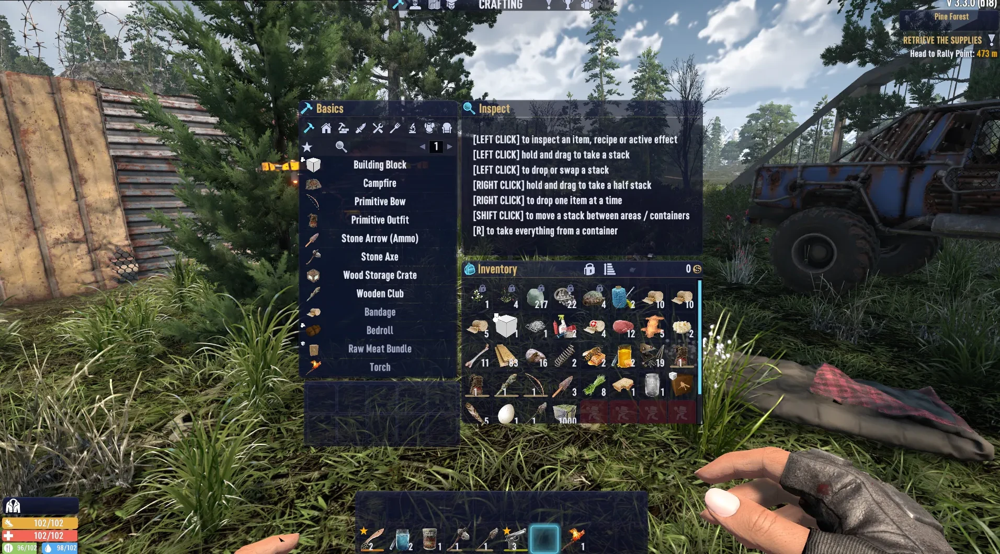
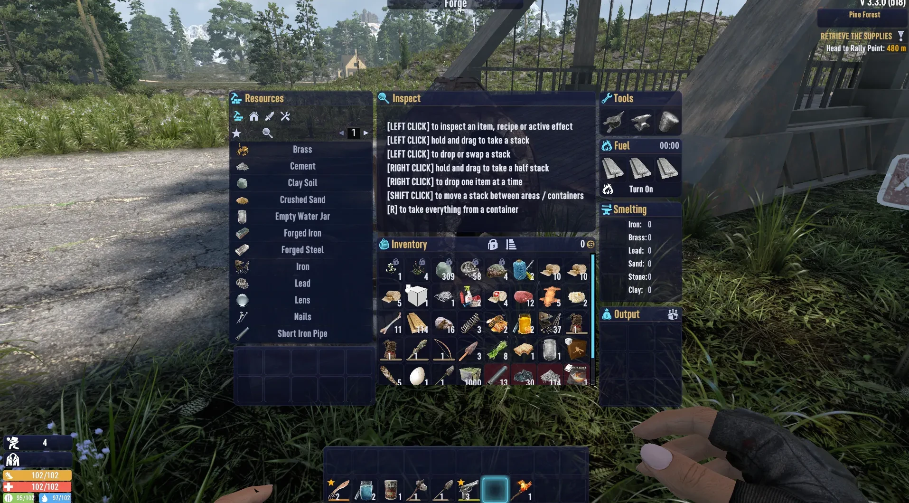
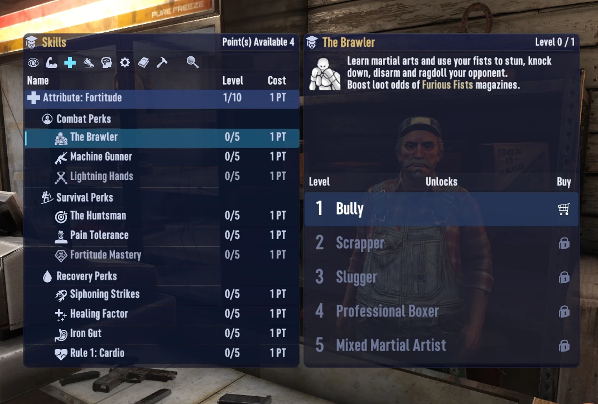
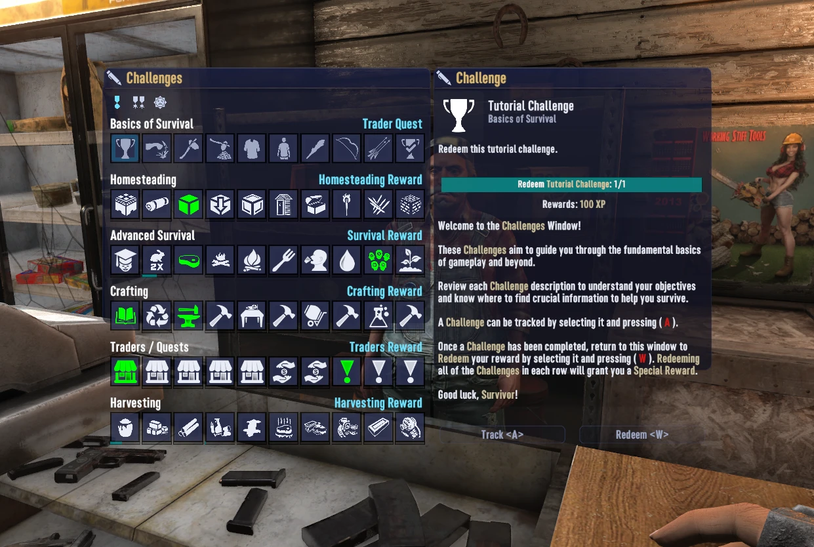
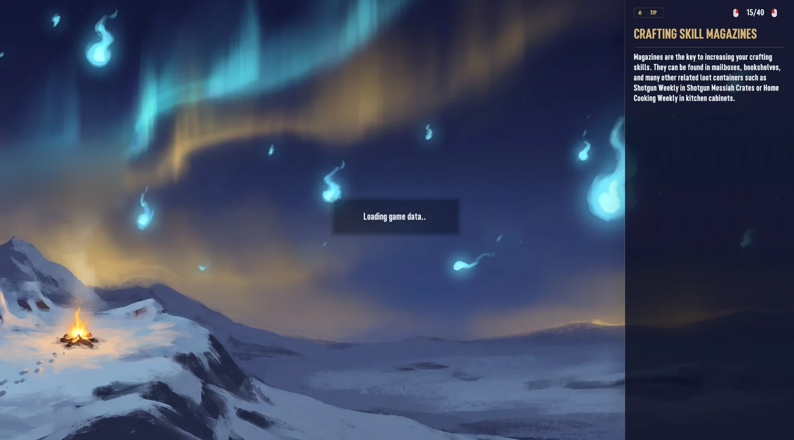
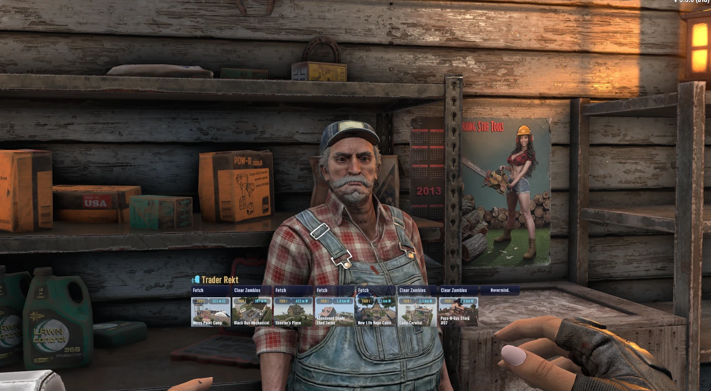
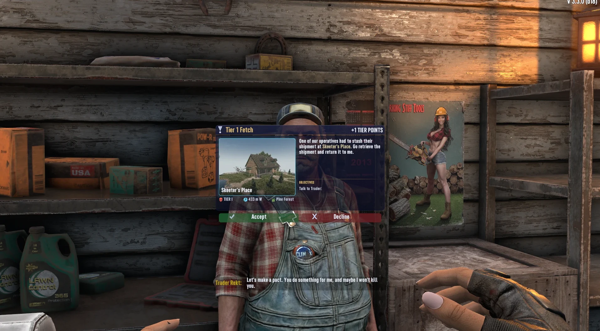

# KitsuneUI

**Kitsunebi**, a night glass interface for 7 Days to Die V3.x: deep indigo glass panels, fox-fire cyan accents and gold titles, across every screen in the game.

**Get it:** [Nexus Mods](https://www.nexusmods.com/7daystodie/mods/13190) · [7 Days to Die Mods](https://7daystodiemods.com/mods/kitsuneui) · [GitHub releases](https://github.com/Kitsune-Den/KitsuneUI/releases/latest)  
**Modders:** [ui.kitsuneden.net](https://ui.kitsuneden.net), the guide to building on KitsuneUI



| | |
|---|---|
|  |  |
|  |  |
|  |  |

**About the screenshots:** they were taken with separate inventory and container mods installed (a bigger backpack, extra crafting queue and workstation slots, bigger stacks), to show the theme stretching to fit them. Those mods are **not** part of KitsuneUI. With KitsuneUI alone, your bags and workstations keep their vanilla sizes.

The theme is XML and images only. It changes how the game looks, never how it plays, and it runs with EAC on.

## What it covers

- **HUD:** health, stamina, food and water bars with an injury hatch, buff pop-outs lined up with the bars, compass, location box, quest and recipe trackers, party bars, enemy health bar.
- **Toolbelt:** a glass tray that grows to fit one or two bars, or one bar of up to 20 slots.
- **Inventory:** backpack, loot, vehicle and drone storage, with rounded slots that glow fox-fire when selected and gold on hover.
- **Crafting:** recipe list, recipe and item details, crafting queue, the creative menu, every workstation (workbench, forge, campfire, chemistry station, cement mixer, dew collector).
- **Trader and quests:** trader stock, services, job offer, quest journal, turn-in rewards.
- **Character:** character sheet, buffs, skills and perks (skills you can study bright, locked ones dim; with the Settings add-on, fully learned ones gold), challenges, cosmetics.
- **Map:** map, waypoints, shared waypoints and the right-click menus.
- **Menus:** the news screen (glass news cards and a Continue button), the main menu as a glass rail down the left edge (it fits 16:9 and ultrawide alike, and the background fills the screen), Play Game with your saves as cards (with KitsuneUI_Settings, each shows its world's map), the server browser and filters, the in-game Esc menu, every Options page, death message and respawn screen. With KitsuneUI_Settings the menus follow your glass colour and strength.
- **Loading screen:** the picture fills the screen and the tip sits in a glass column down the right edge, with the spawn buttons docked at its foot.
- **Everything else:** chat, the player list, power and trap windows, cameras, signs and the sign editor, keypads, tooltips, context menus, tips, message boxes, admin and debug panels.

## Install

1. Download the zips you want from the [Releases](https://github.com/Kitsune-Den/KitsuneUI/releases) page.
2. Unzip each one into your `Mods` folder, so you end up with `Mods/KitsuneUI/ModInfo.xml`. The `Mods` folder is in your game folder, or at `%APPDATA%\7DaysToDie\Mods`.

**Playing on a server:** install it on the **server and on every player's game**. The server sends its UI layout to everyone who joins, so a player without KitsuneUI sees blank spots where the theme's images go. Tell your players before you add it.

| Mod | What it does | EAC |
|---|---|---|
| `KitsuneUI` | The theme | Works with EAC on |
| `KitsuneUI_Toolbelt20` (optional) | Two toolbelt bars of 10, or one bar of up to 20 | Small DLL, needs EAC off |
| `KitsuneUI_JobPreview` (optional) | Trader jobs as picture tiles, and a job offer with the location's picture | Small DLL, needs EAC off, needs `KitsuneUI` |
| `KitsuneUI_Settings` (optional) | An in-game settings window (Esc menu > KitsuneUI), saved per player | Small DLL, needs EAC off, needs `KitsuneUI` |
| `KitsuneUI_Loading` (optional) | Six Kitsunebi night paintings for the loading screen | Works with EAC on |
| `KitsuneUI_Practice` (optional) | For Kitsune Shugyō: a Practice tab with every practice meter, and practice bars on the skills screen | Small DLL, needs EAC off, needs `KitsuneUI`; does nothing without Kitsune Shugyō |

### Languages

KitsuneUI follows the game's language setting. Most of what you see is the game's own text, already translated; KitsuneUI's own text (the settings window, move mode, the SHIFT tag and the loading screen's TIP tag) is translated into all 13 languages the game supports: English, German, Spanish, French, Italian, Japanese, Korean, Polish, Brazilian Portuguese, Russian, Turkish and Simplified and Traditional Chinese. The translations are ours, not native-reviewed: corrections are welcome (open an issue, or edit `Config/Localization.csv`).

### Works with mods that resize things

Windows that other mods resize are restyled in place. They keep their vanilla names, and their glass panels are anchored to the grids rather than sized with fixed numbers, so bigger bags, containers, toolbelts and workstation grids still fit. Tested with KitsuneBackpack, KitsuneStorage and KitsuneMoreSloots.

Other mods that rebuild the same windows from scratch (full UI overhauls) will clash with it. Use one UI theme at a time.

### Removing it

Delete the folders. The theme stores nothing in your save (the Settings add-on keeps one small file, `%APPDATA%\7DaysToDie\KitsuneUI\settings.txt`). For the toolbelt add-on, see [Removing it](#removing-it-1) below.

## KitsuneUI_JobPreview

(Screenshots in the gallery at the top.)

Talking to a trader shows the options as a strip of tiles under the trader, above the toolbelt. A job tile shows the job ("Clear Zombies") over the location's preview picture, with the place name across the bottom, a tier badge in the corner and the distance and direction in a badge. Other options (Let's trade, Nevermind) are text-only tiles. Buried supplies, which have no building, show a painted dig-site picture with the distance and the biome. The job offer window shows the location's picture with its name, tier, distance and biome, the description, every objective of the job (head to the rally point, clear the areas, talk to the trader...), and wide Accept / Decline buttons.

The pictures are the preview images the game already ships with every POI (`Data/Prefabs/POIs/<name>.jpg`; modded POIs use the image next to their prefab). Two small XUi controllers in the DLL read the job behind each dialog row and behind the offer window, and hand the window XML the picture path, name, tier, distance, direction, biome and objectives. Distance and direction use the game's own formatting.

With `KitsuneUI_Settings`, each player can switch the tiles off ("Trader jobs as picture tiles") and get the game's normal dialog list, in KitsuneUI's glass. The strip is its own window next to the game's list, and the choice is read each time a dialog opens. The job offer keeps its picture layout either way.

Needs `KitsuneUI`. Install on the **server and every client**, with EAC off.

## KitsuneUI_Loading

Six night paintings in the Kitsunebi colours replace the vanilla loading pictures: a hilltop den ringed by fox-fire, a ghost town with a spirit fox, a burnt forest with a lantern trail, a desert gas station, a frozen radio tower under an aurora, and horde night under a blood moon. Each one keeps its subject to the left, so the tip column never covers it. Four KitsuneUI tips (Move HUD, sharing profiles, the backpack search and the horde countdown) join the game's loading tips, in all 13 languages.

It is XML and images only (EAC on). The server sends its list of loading pictures to everyone who joins, so on a server install it on the **server and every client**; a player without it sees an empty background instead of a picture. To mix the paintings in with the vanilla ones rather than replace them, delete the `remove` line in `Config/loadingscreen.xml`.

The game picks a loading picture at random, but it seeds that pick from the frame count, so a launcher that starts the game and connects straight away lands on the same picture every time. With `KitsuneUI_Settings` installed, the pictures take turns instead, so you see every one before any repeats.

## KitsuneUI_Practice

For [Kitsune Shugyō](https://github.com/Kitsune-Den/KitsuneShugyo), where you get better at what you do. Its practice meters fill quietly in the background, and practice you can't see feels like nothing is happening, so this add-on puts them on screen.

- **Practice tab.** A flame tab in the top bar, after Players, opens a window with the five attributes and all 24 crafting skills. Each row has the rank or level, a bar towards the next one and its percentage. A tired attribute gets an amber bar and a **Tired** tag (practice counts at a quarter until it rests). A skill at its maximum says **Mastered**. Hover a row for "42% of the way to rank 5" and, with Shugyō 0.5.0 or later, where that practice came from: its top three sources as shares of everything recorded for it ("Kills 62% · Tool hits 30% · Magazines 8%"). Shugyō only records sources from 0.5.0 on, so practice from before then isn't counted, and with an older Shugyō the line is left out. The window keeps up while it's open, so a magazine a party member reads shows straight away.
- **Skills screen, attributes.** Ranks are earned, not bought, so the Buy cart and its "Buy: N skill points" tooltip are gone from the ranks you don't have yet (ranks you have keep their check mark). The next rank's row carries the practice bar along its bottom and the percentage where the cart was, the column says **Practice** instead of Buy, and hovering it says "Earned by practice, not bought." In the skill list on the left, an attribute's Cost column shows its practice percentage.
- **Perks.** A perk's next rank says which attribute rank unlocks it while that rank is still to earn: "Unlocks at Perception Level 5".

Level-up, rank-up and fatigue messages come from Shugyō itself; this add-on only shows what's there.

It reads Shugyō's meters (`$shugyo_<skill>`, `$shugyo_<attribute>` and `$shugyo_fatigue_<attribute>`, see Shugyō's README), so it works with any Shugyō from 0.1.0: before 0.2.0 attributes are still bought, so the attribute screen stays as it is and the Practice tab shows just their ranks. Tired tags need 0.3.0.

**Without Kitsune Shugyō** it does nothing: no Practice tab, and the game's attribute rows, Buy button and skill list stay as they are. The same goes when Shugyō is installed but refuses to start (it does while a mod it replaces is still installed).

Needs `KitsuneUI`. Install on the **server and every client**, with EAC off, like Shugyō itself.

## KitsuneUI_Settings

Adds a **KitsuneUI** button to the Esc menu, under Options. It opens a settings window with eight pages on a rail down the left: **HUD**, **Toolbelt & bars**, **Map**, **Unit frames**, **Combat**, **Backpack & items**, **Traders & quests** and **Look**. Each page groups its options under headings, a strip at the bottom says what the option under the mouse does, and options that need another one (the minimap's, the unit frames') dim while it's off:

| Setting | Off means |
|---|---|
| Toolbelt slot numbers and SHIFT tag | No key numbers on the toolbelt |
| Enemy health bar always shown | The game's default: the bar only shows in god mode |
| Trader options | **List** is the game's dialog list. **100%**, **125%** or **150%** shows the options as picture tiles (needs `KitsuneUI_JobPreview`) at that size, centred under the trader; bigger tiles grow upward, clear of the toolbelt |
| Show the whole backpack | The bag scrolls as usual. On, the bag gets more columns of smaller slots so every slot fits without scrolling. It fits the slots your bag really has, and a button in the backpack header switches it on and off with the inventory open |
| Backpack width | Normal. **Wide** or **Extra wide** makes the bag window wider: bigger slots with the whole backpack showing, more slots per row when it scrolls. The inventory's other columns move out to make room |
| Fade the toolbelt and stat bars when idle | They stay solid. On, they fade after a few quiet seconds and come straight back when you switch or use an item, take damage, run, get hungry or thirsty, crouch or open a menu |
| Show the minimap | No minimap. On, a glass minimap sits in the top right, drawn from your own explored map, with the map's markers (quest targets, waypoints, bed, backpack, vehicles, party); markers out of view sit on its edge. **Zoom** shows 64, 128 or 256 blocks across; **View** is North up (the arrow turns) or Turn with me (the map turns, the N circles the edge), and both follow the vehicle you're driving; **Names** labels players and named waypoints; **Shape** is Square or Round. Two more switches put **your coordinates** and **the day and time** on a strip under the map |
| Creatures on the minimap | No dots. **Animals** shows animals inside the map's view as dots (orange for ones that attack, green for ones that don't); **All** adds zombies and bandits in red. Only what's inside the view, never pinned to the edge |
| Search box in the backpack | No search. On, a search field in the backpack header dims every slot whose item name doesn't match what you type. V3.3 only: V3.4 has its own category and text filters, so the setting isn't shown there |
| Time left beside buffs | Icon-only buffs show just the icon. On, buffs with an end show their time left (4:32) |
| Warn when a toolbelt item is nearly worn out | No warning. On, a toolbelt slot gets an amber ring under 20% durability and a red one under 5% |
| Action bar | Nothing extra. On, while you reload, eat, drink or use medicine (on yourself or someone in front of you), a glass bar above the toolbelt shows the item, what you're doing, the time left and a filling bar |
| Size | Needs `KitsuneUI_Toolbelt20`. **Stacked** is two bars of 10; **One bar** is a single bar of 10 to 20 slots (pick the length with the arrows), where slots past 10 are Shift + 1, 2, ... The size is the toolbelt inventory itself, so it isn't a per-player setting: it's saved into `KitsuneUI_Toolbelt20/Config/toolbelt.xml` and used from the next time a world loads. On a server the server's file wins; the window says what's in use now while it differs from what you saved. Two bars of 10 and one bar of 20 keep every item in place; a smaller belt moves the extra items to the backpack (or drops them if it's full) |
| Two bars shown as | Only shown while the toolbelt in use has two bars. **Stacked** puts one bar on top of the other, and while the backpack is open the windows with it (inventory, loot, crafting, trader) sit higher, so the top row doesn't cover the bag; skills, map and quests stay where they are. **Side by side** puts all 20 slots in one row: 1 to 0 on the left, Shift + 1 to 0 (gold numbers) on the right, same keys. It's about 1,500 wide, so it suits 16:9 and wider screens |
| Item slots ringed in their quality colour | No rings. On, every item with a quality gets a thin ring inside its slot in its quality colour (the colour of its durability bar), in the backpack, toolbelt, loot and workstations |
| Compare with the item in your hand | Weapons and tools compare only with another item you've selected. On, hovering a weapon or tool also shows how its stats differ from the one in your hand, like armour compares with what you wear |
| Quest tracker: progress bars and a direction arrow | The game's tracker. On, objectives that count ("3/10") get a thin progress bar, and "go to" objectives get an arrow pointing the way from where you're facing |
| Trader jobs | **By tier** is the game's own pages, a tier at a time. **By distance** lists the jobs of every tier you've unlocked together, nearest first, with their tiers (7 at a time, with "Closer jobs" and "Farther jobs" rows to page through them). **No tiers** does the same without the tier tags: quest names lose their "Tier 1", the offer and quest log lose the tier progress line, and POIs lose their difficulty skulls in the location box and the "Entering" title (biome skulls stay), so you scout the danger yourself |
| Glass | 100%, 85%, 70% or 55% strength for the glass panels |
| Glass colour | Midnight (the Kitsunebi indigo), Charcoal, Obsidian, Forest, Plum, Ember or Ocean glass; the gold stays gold |
| Colours | Kitsunebi, Ember (amber), Moss (green) or Sakura (pink): swaps the fox-fire, gold, selection and outline colours; the game's own colours (rarity, health) stay. **Custom** offers 12 hue swatches that build a palette from any colour |
| Bar text | How the health, stamina, food and water bars write their value: 100/100, 100%, the value only, or no text |
| Unit frames by the crosshair | The game's bars. On, ElvUI-style frames sit either side of the crosshair: yours (name, level, health, stamina, food, water) with your buffs and debuffs as icons above it (each with the number the game's buff list shows under it: time left, your temperature when cold, how wet you are), and your target's (name, BOSS tag, health) with its harmful effects above it. The vanilla bars, buff list and enemy bar hide while it's on |
| Separate XP bar above the toolbelt | On by default: the XP bar as its own glass bar above the toolbelt, with your level and progress written on it. Off, it's the thin strip on the toolbelt's top edge |
| Bar style | 15 textures for every bar on the HUD (the stat, enemy, vehicle, party and block health bars, the unit frames, XP bar and crafting card): Kitsunebi, Flat, Smooth, Glossy, Glass, Bevel, Inset, Neon, Brushed, Striped, Scanline, Split, Fade, Outline and Minimal |
| Party frames under your frame | With unit frames on, the other members of your party stack under your frame: name, distance and health, greyed out while they're dead. On by default |
| Nameplates over enemies you're fighting | No plates. On, health bars with names float over enemies fighting you (ones you've hit lately, ones attacking you, your target), within 40 m, nearest 12; gold for a boss. Enemies that haven't noticed you get no plate |
| Floating combat text | No numbers. On, your hits rise off what you hit (headshots bigger and gold, crits with "!", kills white), damage you take rises red and heals rise green |
| Frame width, buff icons, buffs shown | Unit frame options: Narrow, Normal or Wide frames; Small, Normal or Large buff icons; 4, 6 or 8 buffs per frame |
| Debuffs in their own row, countdown sweep on buffs | One mixed row. On, your frame puts harmful effects (bleeding, infection, sprains) in their own red-edged row above your buffs, every icon gets a dark sweep that grows as it runs out, and the game's own buff list gets the sweep and a red ring on harmful effects |
| Portrait | No portraits. **Clean** or **Painted**: your frame gets a round portrait of your own character (a snapshot with your gear on, taken again when your gear changes) with your level, party members get theirs beside their rows, and the target frame shows a portrait of whatever you target, with a coloured ring for feral, radiated, charged or infernal and gold for a boss. Zombies, traders and bandits get a real picture of their own model (every vanilla one comes with the add-on; modded ones are photographed the first time they face you), animals a painted one. Painted brushes the snapshots to match. In the console (F1), `kp` retakes the picture of your current target, and `kp all` (single player or hosting) spawns every zombie, trader and bandit without a picture in front of you, one at a time, and photographs it; `kp all again` redoes them all |
| Horde night countdown | Nothing extra. On, a line under the compass's day and time counts down to the next blood moon ("Horde night in 3 days"), orange the day before and red on the night; it follows the server's blood moon settings |
| Crafting progress on the HUD | Nothing extra. On, while your own crafting queue is busy, a small glass card shows the item, how many are left, the time left and a bar for the one being made (crafting from your inventory, not workstations) |
| Text size | 90%, 100%, 115% or 130% for in-game text. Text in tight boxes shrinks back to fit, so it mostly grows descriptions, lists and chat |

**Move HUD** (a button in the same window) puts the HUD in move mode: a soft grid with a centre line covers the screen, every HUD piece shows a glass outline with its name and controls on a strip just outside it, and you drag them where you want them; pieces can't be lost off the edge of the screen. Pieces: stat bars, toolbelt, compass / time, location, the "Entering" title, quest and recipe trackers, chat, subtitles, ammo, looted items, vehicle bars, pop-ups, enemy health, party bars, the minimap, the crafting card, the unit frames, the party frames, the XP bar and the action bar. Each outline also has a size readout with **-** and **+** buttons (60% to 160%) and an **eye** to hide the piece (a hidden piece shows with a red outline in move mode, so you can bring it back). **Snap to grid** (on by default) lines a piece's corner up with the grid; **Reset** puts every position, size and hidden piece back. Trackers and party bars can be moved while they're showing. The **stat bars** button (on the same bar) switches the stat bars between **together** (one piece), **in pairs** (Health & Stamina, Food & Water) and **apart** (a piece per bar, so health and stamina can sit on opposite sides). Apart from together, the buff pop-outs are a piece of their own. With unit frames on, in pairs takes food and water out of the player frame onto their own strip, and apart makes food, water and stamina each a glass piece of their own, with full-height bars, icons and values.

**Profiles** save the whole layout (positions, sizes, hidden pieces, glass, toggles, colours) under a name, up to 8, to load or delete later. **Export** copies a layout to the clipboard as one line of text you can paste to other players; **Import** reads one back (only KitsuneUI's own settings are accepted). **Presets** switch HUD pieces on and off in one click: **Minimal**, **Full** or **Streamer** (Full minus combat text, text at 115%, a round minimap with the clock, and no coordinates or player names on the map). Presets never move or recolour anything.

Changes apply straight away. They are saved per player in `%APPDATA%\7DaysToDie\KitsuneUI\settings.txt`, so on a server every player picks their own. The defaults match KitsuneUI without the add-on, so nothing changes until someone flips a switch.

Needs `KitsuneUI`. Install on the **server and every client**, with EAC off (the server sends the window's layout; the DLL does the work on each player's game).

## KitsuneUI_Toolbelt20

Two toolbelt bars of 10 slots. Number keys use the bottom bar, shift + number uses the top bar (marked with a SHIFT tag, and its slot numbers are gold). Or one bar of 11 to 20 slots, see [Changing the size](#changing-the-size).

V3.3 already supports up to 2 bars of 10 and up to 10 pages, and the vanilla toolbelt window already draws them. The setting lives in `Data/Config/toolbelt.xml`, but the game only reads its `<editorconfig>` section (the prefab editor). The DLL makes it read a `<gameconfig>` section too, and `Config/toolbelt.xml` adds one with 2 bars of 10.

Install on the **server and every client**, with EAC off. It works with or without KitsuneUI.

It also makes room for the extra slots when you die. With drop-on-death set to everything, the bag, the toolbelt and your equipment go into one dropped bag, and anything that doesn't fit is lost. So it grows the death bag by 2 rows, and the loot window's slot pool to match:

| Installed with | Death bag | Loot window pool |
|---|---|---|
| nothing else | 8x15 to 8x17 | 9x10 to 9x16 |
| KitsuneBackpack | 8x20 to 8x22 | 12x14 to 12x20 |
| KitsuneBackpack200 | 8x28 to 8x30 | 12x19 to 12x20 |

### Removing it

Safe for items: when the game loads a 20-slot belt into a 10-slot one, the extra items go into your backpack, and anything that doesn't fit drops at your feet.

### Changing the size

Pick it in KitsuneUI Settings (**Toolbelt & bars > Size**), which saves it into `KitsuneUI_Toolbelt20/Config/toolbelt.xml`, or edit that file yourself. It applies from the next time a world loads. On a server, the server's file decides and it sends the size to every player:

- **Two bars of 10** (the default): `slot_per_bar="10" bar_per_page="2"`.
- **One bar of 11 to 20**: say `slot_per_bar="15" bar_per_page="1"`. 1 to 0 pick slots 1-10, Shift + 1, 2, ... pick slot 11, 12, ... The bar stays centred, and with KitsuneUI slots 11 and up get gold numbers and a SHIFT tag at the end. A wide bar meets the bottom corners of the HUD on 16:9 screens, like the one-row layout.

Two bars of 10 and one bar of 20 keep every item where it is, so you can switch between them. Going smaller moves the extra items into the backpack. For 10 or fewer, the game clamps `slot_per_bar` to 1-10, `bar_per_page` to 1-2 and `page_count` to 1-10, and more than one page shows the vanilla page arrows. The death bag sizes above cover up to 20 slots.

Don't combine it with another mod that changes the toolbelt size (a 15-slot toolbelt mod, say): both change how the game reads it.

## For modders

### Building on KitsuneUI

Your mod's windows can wear the Kitsunebi glass, follow each player's look settings, and join Move HUD, while staying vanilla for players without KitsuneUI. See **[ui.kitsuneden.net](https://ui.kitsuneden.net)** (or [Building on KitsuneUI](docs/framework.md) here in the repo): the colours, sprites and templates you can use, the one rule (wrap them in `mod_loaded('KitsuneUI')`), and the one-line Move HUD handle. KitsuneRadio is the first mod built this way.

### Ground rules

- **The theme has no dependencies.** No DLL, no Harmony, no custom XPath ops, no other mods. Only XML (XUi) and UIAtlas sprites, so it runs with EAC on.
- **The theme is UI only.** No gameplay changes. Bag sizes belong in KitsuneBackpack, container sizes in KitsuneStorage.
- **Never size around a grid with fixed numbers.** Anchor to the grid (`anchor_bottom="grid,0,-6"`) so other mods can resize it.
- **Our own art and code.** Terminal UI was the reference for what to cover, not a source to copy.

### How it's built

- **Palette.** The Kitsunebi colours are `ku*` style entries in `Config/XUi_Common/styles.xml`. `kuAccent` drives every selection, glow and active state. The vanilla greys and selection colours are moved onto the palette too, so windows from other mods fit in.
- **Vanilla red.** `tools/gen_menu_recolor.py` finds every vanilla red (228,18,21 and friends) and writes a GENERATED block at the top of each patch file that recolours it. Hand-written patches come after it, so they win.
- **Rows coloured by game code.** Recipe rows, waypoint rows and several buttons are coloured by code that swaps their sprite between `menu_empty` and `ui_game_select_row`. Those sprites point at a separate atlas, `KitsuneRows`, holding our own versions of both names, so nothing else in the game changes.
- **Art.** Every sprite is drawn by `tools/gen_sprites.py` (Python 3 + Pillow), which writes the PNGs and their 9-slice borders (`settings.xml`) into `KitsuneUI/UIAtlases/`, and a preview sheet to `docs/sprites.png`. Change the script, not the PNGs.

```
python tools/gen_sprites.py
```

### Checking patches

`tools/check_patches.py` (Python 3 + lxml) applies every patch to the vanilla XUi files in load order and lists any XPath that matches nothing. A dedicated server never loads the menu XUi or the atlases, so this is the only check that covers everything:

```
python tools/check_patches.py "<game>/Data/Config" KitsuneUI/Config KitsuneUI_JobPreview/Config KitsuneUI_Practice/Config KitsuneUI_Settings/Config KitsuneUI_Toolbelt20/Config KitsuneUI_Loading/Config --loaded KitsuneShugyo
```

A `<conditional>` takes its first branch whose `mod_loaded()` passes, counting the folders given and the `--loaded` names as installed. Leave `--loaded KitsuneShugyo` off to check the Practice add-on without Shugyō (nothing of it applies).

### Building the DLLs

The projects reference the game's DLLs from `7dtd-binaries/` (not committed). Copy these into it from your game install: `Assembly-CSharp.dll`, `LogLibrary.dll`, `NGUI.dll`, `UnityEngine.CoreModule.dll` and `UnityEngine.IMGUIModule.dll` from `7DaysToDie_Data/Managed`, and `0Harmony.dll` from `Mods/0_TFP_Harmony`. Then:

```
dotnet build src/KitsuneUI.Toolbelt20 -c Release
dotnet build src/KitsuneUI.JobPreview -c Release
dotnet build src/KitsuneUI.Settings -c Release
dotnet build src/KitsuneUI.Practice -c Release
```

`src/Shared/KitsuneSettingsFile.cs` (the settings file) is compiled into both JobPreview and Settings, so neither DLL needs the other.

Each DLL is copied into its mod folder.

### Release zips

```
python tools/package.py
```

writes `dist/<Folder>-<Version>.zip` for each mod, with the mod folder at the zip's root. The version comes from each `ModInfo.xml`.

### Loading pictures

`tools/gen_loading_art.py` regenerates the KitsuneUI_Loading paintings (Gemini image generation, 21:9). It reads the API key from `GEMINI_API_KEY`, keeps the raw PNGs in `build/` and writes the game's JPEGs into `KitsuneUI_Loading/Textures/`.

### Design

The mocks behind the Kitsunebi direction (night indigo glass, fox-fire cyan accent, gold hairlines), including the gameplay HUD, job tiles and job offer layouts, are in `docs/mocks/`.

## Credits

Inspired by [Terminal UI](https://www.nexusmods.com/7daystodie/mods/12967) by SkyLett. All art and code here is our own.

## License

[CC BY-NC-SA 4.0](LICENSE), with an extra permission for servers that make money: see [NOTICE.md](NOTICE.md). In short: play it, change it and share it, with credit, not for sale, and with changed versions under the same license.
